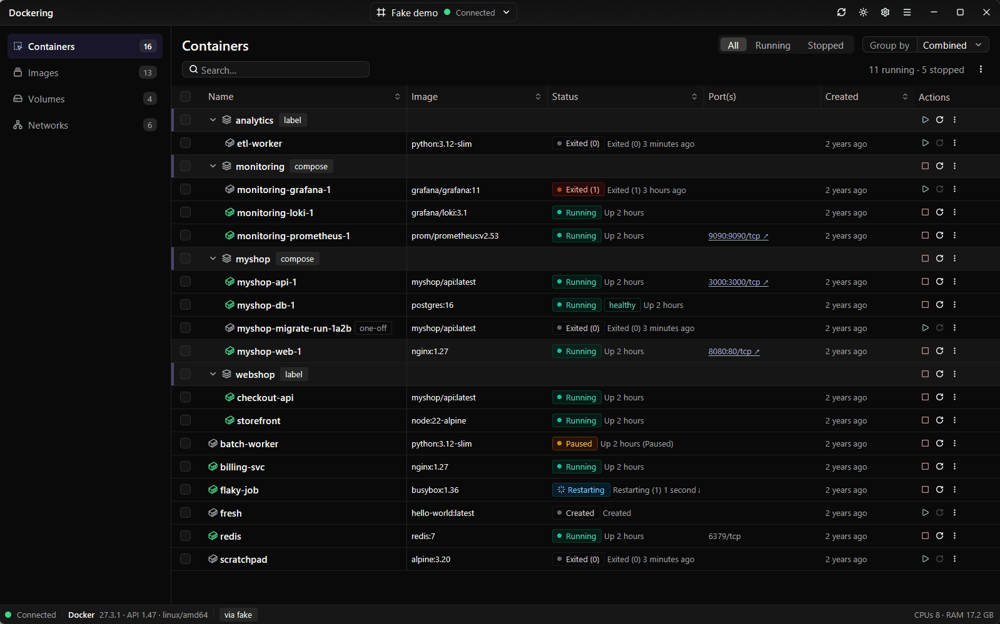
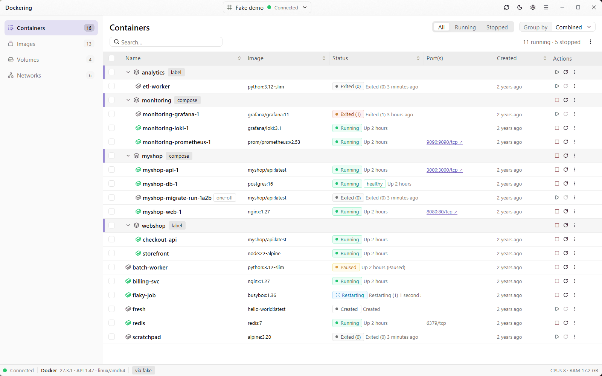
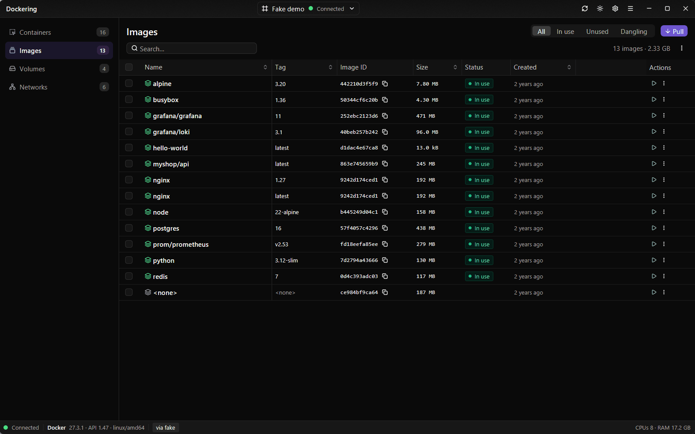
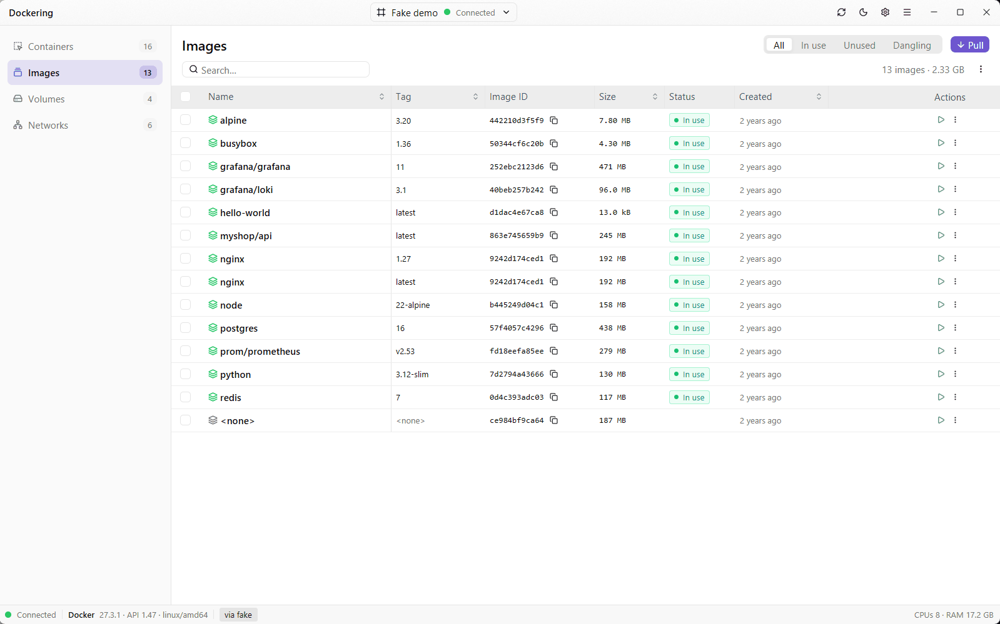

# Screenshots

Dockering running against the built-in demo data (`dockering --demo`), in both themes.
Back to the [README](../README.md).

## Containers

Containers grouped by Compose project and label.

| Dark | Light |
|---|---|
|  |  |

## Images

| Dark | Light |
|---|---|
|  |  |
